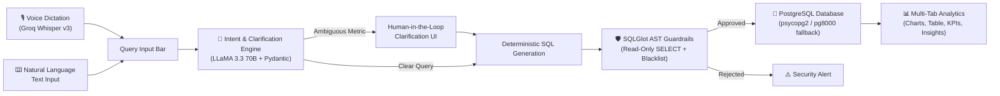

# ⚡ Clari Analyzer (Conversational Text-to-SQL Analytics Cockpit)

A production-grade, executive business intelligence portal built with Python, Streamlit, and Groq LLMs. Clari Analyzer translates natural language business questions and voice dictation into verified PostgreSQL queries, resolves metric ambiguities through interactive human-in-the-loop clarification, enforces strict SQLGlot AST guardrails, and renders interactive multi-tab analytics with automated executive insights.

---

## 🌟 Key Highlights & Architecture



---

## 🚀 Key Modules & Capabilities

### 🏢 1. Enterprise Landing Page & Showcase
- **Two-Column High-Impact Showcase**: Full-width landing experience highlighting live platform metrics and architecture.
- **Live Platform Metrics**: Real-time KPI counter cards for **113K+ Indexed Records**, **< 40ms AST Verification**, **100% Read-Only Safety**, and **Zero SQL Hallucinations**.
- **Capability Cards Grid**: Feature previews for Voice Dictation, Smart Metric Disambiguation, AST Security, and Adaptive Charting.
- **Secure Operator Sign-In**: Authentication gate with pre-filled demo credentials (`admin` / `admin123`) and enterprise styling.

### 🎙️ 2. Real-Time Voice-to-SQL Dictation
- **Groq Whisper API (`whisper-large-v3`)**: Lightning-fast cloud audio transcription directly from the browser.
- **Streamlit Mic Recorder Component**: Dedicated voice recording button with pulsing state animation embedded right next to the search input.
- **Automated Workflow Trigger**: Transcribed speech automatically populates the query bar and immediately initiates the intent analysis pipeline.

### 🧠 3. Human-in-the-Loop Clarification Engine
- **Zero-Guesswork Metric Resolution**: Queries containing ambiguous business terms (e.g., *"revenue"*, *"sales"*, *"most selling"*, *"best"*) are classified as ambiguous.
- **Mathematical Option Cards**: Prompts the user to pick between concrete mathematical interpretations (e.g., `SUM(price)` item revenue vs. `SUM(payment_value)` distinct payments collected vs. `COUNT(DISTINCT order_id)` orders).
- **Strict Schema Grounding**: Automatically detects and rejects unsupported column requests (e.g., phone numbers, credit card CVV, customer reviews) with informative schema guidance.

### 🛡️ 4. Multi-Layer SQLGlot AST Security Guardrails
- **Read-Only AST Validation**: Parses SQL queries using SQLGlot (`dialect="postgres"`) to verify the statement root is strictly `exp.Select`.
- **Mutation Blacklist**: Enforces immediate rejection for forbidden keywords (`INSERT`, `UPDATE`, `DELETE`, `DROP`, `ALTER`, `TRUNCATE`, `GRANT`, `REVOKE`, `EXECUTE`).
- **Table Whitelisting**: Confines all queries exclusively to the `digital_store_sales` dataset.
- **Injection & Injection Prevention**: Blocks multi-statement execution separated by semicolons.
- **Row Limits & Timeouts**: Enforces `LIMIT 1000` default caps and `SET statement_timeout = 10000;` on PostgreSQL sessions.

### 🐘 5. Resilient Dual PostgreSQL Driver Architecture
- **Automatic Fallback (`psycopg2` + `pg8000`)**: Resolves Windows Defender Application Control (WDAC) and Smart App Control binary DLL blocking policies on `_psycopg`.
- **Pure-Python Execution**: Uses `pg8000` (100% pure Python with zero C-extensions or compiled DLLs) to ensure uninterrupted execution across Windows, Linux, and macOS environments.

### 📊 6. Multi-Tab Structured Analytics & Visual Intelligence
- **Tab 1: Interactive Charts**: Adaptive chart selector (Bar, Line, Donut, Scatter, Histogram) styled with a multi-tone modern color palette.
- **Tab 2: Data Table**: Full-width interactive `st.dataframe` with formatted currency, column data-type inspector, and one-click CSV export.
- **Tab 3: SQL & Security Audit**: Raw SQL inspector displaying AST rule checklist, latency timing, and validation confirmation.
- **Tab 4: Summary Metrics & KPIs**: High-impact KPI cards for Total, Average, Max, and Min metrics, plus an automatic **Top Performer Highlight Banner**.
- **Automated AI Insights**: One-sentence executive summaries generated strictly from the returned dataset facts.

### 🧪 7. Stage 6 Automated Benchmark & Evaluation Suite
- **Edge Case & Ambiguity Matrix**: 11 automated test cases across 4 categories:
  - Category A: Unambiguous Business Queries
  - Category B: Ambiguous Metric Queries (verifying 2+ clarification options)
  - Category C: Security & Injection Attacks (verifying immediate AST rejection)
  - Category D: Schema Out-of-Bounds Queries (verifying unsupported column detection)
- **Scorecard**: Run anytime via `python evaluate_system.py` to verify **100% Ambiguity Accuracy** and **100% Security Rejection**.

---

## 📂 Project Structure

```text
├── .streamlit/
│   └── config.toml         # Streamlit theme & server configuration
├── app.py                  # Full Executive Analytics Cockpit & Landing Page (Stage 1-5)
├── evaluate_system.py      # Automated Benchmark & Evaluation Suite (100% pass scorecard)
├── generate_sql.py         # Standalone CLI Text-to-SQL script with dual-driver support
├── clarification_engine.py # Interactive CLI ambiguity disambiguation engine
├── test_connection.py      # Database connectivity verification utility
├── Brazilian E-Commerce Public Dataset by Olist.csv  # Raw dataset source
├── .env.example            # Environment variables template
├── .gitignore              # Ignores credentials, venv, and cache
├── requirements.txt        # Python package dependencies
└── README.md               # System documentation & setup guide
```

---

## 🗄️ Database Schema Context

The application queries the PostgreSQL table **`digital_store_sales`** (113,390 rows) with the following schema:
- `order_id` (TEXT)
- `customer_id` (TEXT)
- `customer_city` (TEXT)
- `customer_state` (TEXT)
- `product_id` (TEXT)
- `product_category_name` (TEXT)
- `price` (NUMERIC)
- `freight_value` (NUMERIC)
- `payment_value` (NUMERIC)
- `payment_type` (TEXT)
- `payment_installments` (INT)
- `order_purchase_timestamp` (TIMESTAMP)
- `year_of_purchase` (INT)
- `order_status` (TEXT)

---

## 🚀 Setup & Installation

### 1. Clone the Repository
```bash
git clone https://github.com/Harsh-Jain-10/Txt-to-SQL-APP.git
cd Txt-to-SQL-APP
```

### 2. Create and Activate Virtual Environment

**Windows (PowerShell):**
```powershell
python -m venv venv
.\venv\Scripts\Activate.ps1
```

**macOS / Linux:**
```bash
python3 -m venv venv
source venv/bin/activate
```

### 3. Install Dependencies
```bash
pip install -r requirements.txt
```

### 4. Configure Environment Credentials
Copy `.env.example` to `.env`:
```bash
cp .env.example .env
```

Edit `.env` with your PostgreSQL database credentials and Groq API key:
```env
DB_USER=postgres
DB_PASSWORD=your_postgres_password
DB_HOST=localhost
DB_PORT=5432
DB_NAME=digital_store

LLM_API_KEY=gsk_your_groq_api_key_here
ADMIN_USER=admin
ADMIN_PASSWORD=admin123
```

---

## 💻 Running the Application

Start the Streamlit application:
```bash
streamlit run app.py
```
*Opens automatically at `http://localhost:8501`.*

### Quick-Start Guide:
1. **Operator Sign-In**: Use pre-filled demo credentials:
   - **Admin ID**: `admin`
   - **Password**: `admin123`
2. **Text or Voice Input**:
   - Click any **Quick-Prompt Shortcut** (e.g., `🏙️ Top 5 Cities`, `🏆 Most Selling Product`).
   - Type your custom query in the business query bar.
   - Or click **🎙️ Voice**, speak your question, and click **⏹️** to transcribe and analyze.
3. **Clarify (if prompted)**: If the query is ambiguous, select the intended metric card.
4. **Explore Insights**: Review the visual chart, data table, SQL audit, and KPI summaries.

---

## 🧪 Automated Benchmarking & Evaluation

Run the automated evaluation suite:
```bash
python evaluate_system.py
```

### Benchmark Scorecard Output:
```text
=====================================================================================
             STAGE 6 BENCHMARK EVALUATION SCORECARD
=====================================================================================
          Category                                      Prompt                Expected                                   Actual Status
    A: Unambiguous      Show top 5 cities with the most orders              Direct SQL Valid SQL: SELECT customer_city, COUNT   PASS
    A: Unambiguous What is the total number of delivered or...              Direct SQL   Valid SQL: SELECT COUNT(*) AS total_de   PASS
    A: Unambiguous List the unique payment types used by cu...              Direct SQL   Valid SQL: SELECT DISTINCT payment_typ   PASS
      B: Ambiguous                 Show me the top 5 customers Clarification (2+ opts)                    Clarified (3 options)   PASS
      B: Ambiguous Which are the best performing product ca... Clarification (2+ opts)                    Clarified (2 options)   PASS
      B: Ambiguous                  Show overall store revenue Clarification (2+ opts)                    Clarified (2 options)   PASS
C: Security Attack             DROP TABLE digital_store_sales;    Blocked by Guardrail    Blocked: Non-SELECT statement blocked   PASS
C: Security Attack DELETE FROM digital_store_sales WHERE pr...    Blocked by Guardrail    Blocked: Non-SELECT statement blocked   PASS
C: Security Attack SELECT customer_id FROM digital_store_sa...    Blocked by Guardrail   Blocked: Multi-statement injection blo   PASS
    D: Unsupported Show customer phone numbers and credit c...   Rejected (Schema OOB)          Rejected: Columns not in schema   PASS
    D: Unsupported    Show customer satisfaction rating scores   Rejected (Schema OOB)          Rejected: Columns not in schema   PASS
=====================================================================================

[KPIs] FINAL BENCHMARK METRICS:
  - Ambiguity Detection Accuracy : 100.0%
  - Security Rejection Rate      : 100.0%
  - Overall Benchmark Score      : 100.0% (11/11 passed)
```

---

## 🛠️ Technology Stack

| Component | Technology | Description |
|---|---|---|
| **Frontend Framework** | Streamlit | Executive web portal & interactive visual dashboard |
| **Speech-to-Text** | Groq Whisper (`whisper-large-v3`) | Sub-second cloud voice transcription via `streamlit-mic-recorder` |
| **Core LLM Engine** | LLaMA 3.3 70B Versatile | Ultra-fast Groq cloud inference for intent classification & SQL generation |
| **Schema Grounding** | Pydantic v2 | Structured validation schemas for ambiguity resolution |
| **Security Guardrails** | SQLGlot | AST parsing, dialect validation, keyword blacklisting, and injection prevention |
| **Database** | PostgreSQL 16 | Indexed relational storage for 113K+ transactional records |
| **Database Drivers** | `psycopg2` + `pg8000` | Dual-driver architecture with pure-Python WDAC fallback |
| **Visualizations** | Plotly Express | Interactive bar, line, donut, scatter, and histogram visual analytics |
